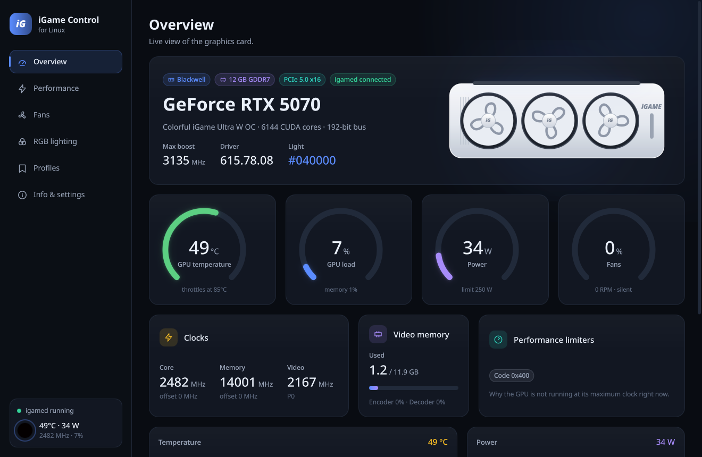
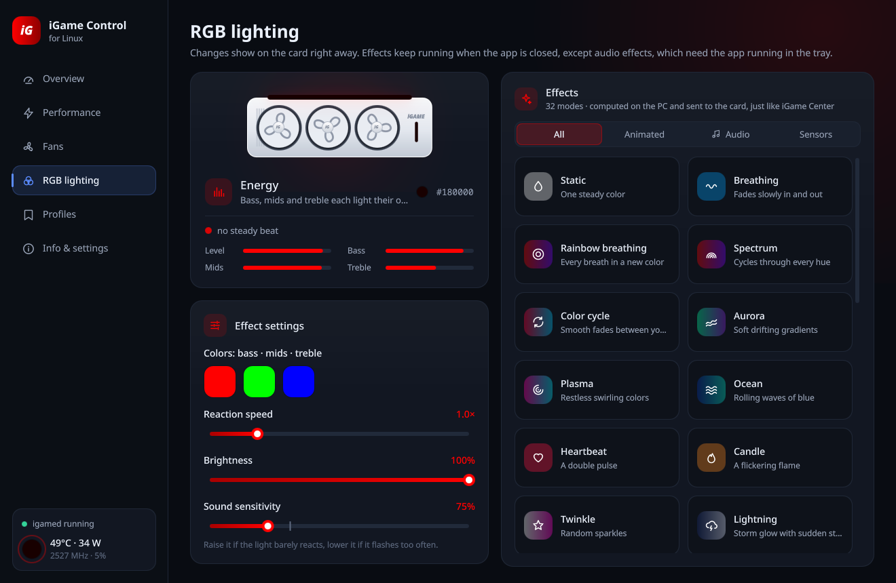
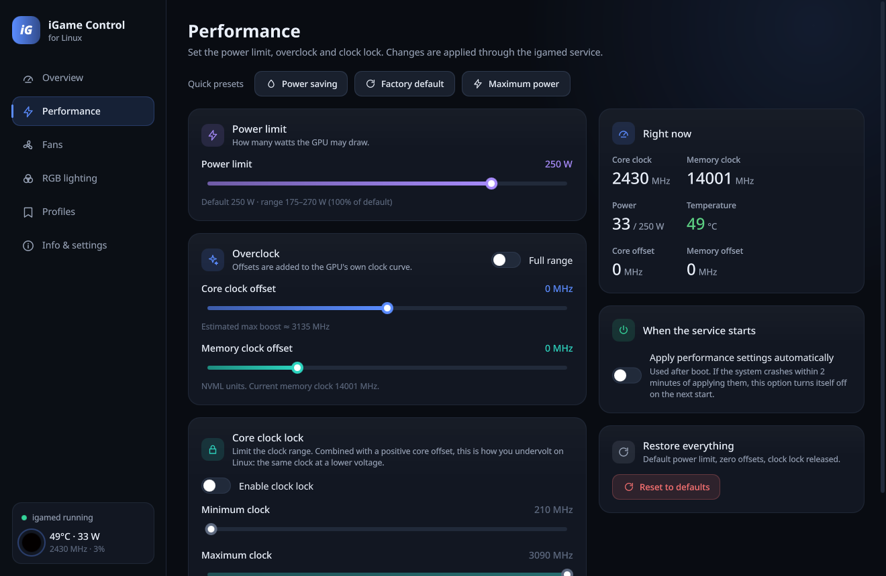
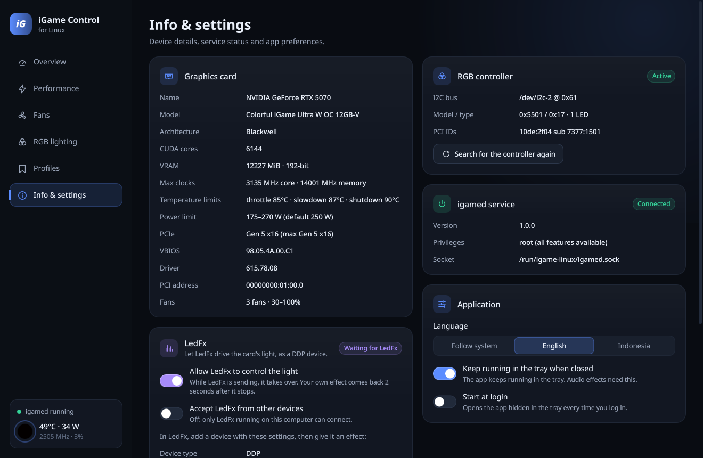

# iGame Control untuk Linux

Pengganti iGame Center dari Colorful untuk Linux: lampu RGB dengan 32 efek (termasuk efek musik
bergaya LedFx dan Smart Sound), power limit, overclock, kunci clock, kurva per kipas, profil,
integrasi LedFx, dan monitoring langsung untuk kartu grafis **Colorful iGame GeForce**.

Dibuat dengan C++ dan Qt 6 (QML), jadi tetap ringan: sekitar 0,7% dari satu core CPU saat di tray
dengan efek musik berjalan.

[](https://github.com/zazazaxky-m/igame-linux/actions/workflows/ci.yml)
[](https://github.com/zazazaxky-m/igame-linux/releases)
[](LICENSE)

[English](README.md) · [Changelog](CHANGELOG.md) · [Kontribusi](CONTRIBUTING.md) · [Keamanan](SECURITY.md)

> **Proyek tidak resmi.** Tidak berafiliasi dengan maupun didukung oleh Colorful atau NVIDIA.
> Colorful, iGame, dan iGame Center adalah merek dagang Colorful Technology; NVIDIA dan GeForce
> adalah merek dagang NVIDIA Corporation. Overclock dan pengaturan kipas menjadi tanggung jawab
> pengguna.

| Ringkasan | Lampu RGB |
|---|---|
|  |  |
| **Performa** | **Info & pengaturan** |
|  |  |

## Fitur

**Ringkasan**
- Gauge suhu, beban, daya, dan kipas; clock core, memori, dan video beserta offset-nya.
- VRAM, beban encoder/decoder, dan penyebab GPU tidak berada di clock maksimal.
- Grafik 2 menit terakhir, dan gambar kartu yang menyala dengan warna LED asli serta kipas yang
  berputar sesuai RPM asli.

**Performa**
- Power limit, offset clock core dan memori (slider dibatasi ±500 / −1000..+3000 MHz kecuali
  "Rentang penuh" dinyalakan), dan kunci clock core. Offset core positif ditambah kunci clock adalah
  cara undervolt di Linux.
- Preset: Hemat daya, Default pabrik, Daya maksimum.
- Opsi "terapkan saat service mulai" dengan pengaman crash: kalau sistem tidak bertahan 2 menit
  setelah pengaturan diterapkan saat boot, opsi ini mati sendiri di start berikutnya.

**Kipas**
- Tiap kipas diatur sendiri atau disamakan semua; mode Otomatis (driver), Tetap (%), atau Kurva.
- Editor kurva (geser titik, klik dua kali untuk menambah, klik kanan untuk menghapus) dengan preset
  Senyap, Seimbang, Agresif, dan Maksimal, plus 0 RPM di bawah suhu tertentu.
- Pengaman: kalau suhu tidak terbaca atau service berhenti, kipas kembali ke driver.

**Lampu RGB**

| Kelompok | Efek |
|---|---|
| Statis dan animasi | Statis, Napas, Napas pelangi, Spektrum, Siklus warna, Aurora, Plasma, Laut, Detak jantung, Lilin, Kerlip, Petir, Glitch, Kedip, Kedip ganda, Strobo, Polisi, Ikut waktu, Mati |
| Ikut sensor | Ikut suhu, Ikut beban, Ikut daya |
| Suara (gaya LedFx) | Smart Sound, Bar, Energy, Scroll, Power, BPM Strobe, Real Strobe, Wavelength, Magnitude, Ambient |

- Palet hingga 8 warna dengan color picker HSV, diingat per efek; kecepatan dan kecerahan.
- Efek animasi dijalankan oleh service, jadi tetap jalan walau aplikasi ditutup.

**Efek suara**
- Audio desktop ditangkap lewat `parec` (monitor dari output default), jadi aplikasi harus tetap
  jalan, minimal di tray.
- Audio diolah seperti di [LedFx](https://www.ledfx.app): melbank 24 pita dari FFT 4096 titik
  60 kali per detik, peak isolation, penguatan otomatis, dan filter penghalus LedFx. Efeknya
  mengikuti Bar, Energy, Scroll, Power, BPM Strobe, Real Strobe, Wavelength, dan Magnitude dari
  LedFx, disesuaikan untuk satu LED (kira-kira seperti seluruh strip LedFx dilihat dari jauh) dan
  dikoreksi gamma seperti di WLED.
- Palet dipakai sebagai gradien LedFx; Energy dan Scroll memakai tiga warna untuk bass, mid, dan
  treble.
- Tempo dan ketukan (untuk Bar dan BPM Strobe) dicari oleh beat tracker yang mengunci ke kick drum,
  jadi nada bass di sela ketukan tidak membuatnya meleset.
- **Sensitivitas suara** 10–300%.
- **Smart Sound** mengenali gaya lagu dari bass, kecerahan suara, kepadatan ketukan, dan tempo,
  lalu memilih efek LedFx dan warnanya: Santai (Wavelength), Pop (Energy), Elektronik (Power),
  Hip-hop (Bar), Rock/metal (Magnitude), Vokal (cahaya hangat), atau Hening. Gaya berganti dengan
  crossfade 1,5 detik dan baru setelah beberapa detik, supaya tidak bolak-balik. Deteksinya
  heuristik; lagu campuran masuk ke gaya terdekat.

**LedFx**
- Service menerima stream [LedFx](https://www.ledfx.app) lewat DDP (UDP port 4048). Selama LedFx
  mengirim, lampu dikendalikan LedFx; efek pilihan di aplikasi kembali 2 detik setelah LedFx berhenti.
- Di LedFx: **Devices → Add Device → DDP**, IP `127.0.0.1`, port `4048`, pixel count `1`, lalu
  pasang efek. 30 fps sudah cukup, kartu menampilkan maksimal 30 frame per detik. Kalau pixel count
  lebih dari 1, warnanya dirata-rata.
- Secara bawaan hanya LedFx di komputer yang sama yang bisa terhubung. Untuk LedFx di komputer lain,
  nyalakan **Terima LedFx dari perangkat lain** di Info & pengaturan dan pakai IP komputer ini.

**Lainnya**
- **Profil:** simpan kombinasi pengaturan performa, kipas, dan lampu, lalu terapkan dengan satu klik.
- **Aplikasi:** ikon tray, jalan saat login (tersembunyi di tray), satu jendela saja, dan
  `igame-control --toggle` untuk membuka atau menyembunyikan jendela dari shortcut keyboard.
- **Bahasa:** Inggris dan Indonesia, bisa diganti langsung di **Info & pengaturan → Aplikasi →
  Bahasa**.

## Perangkat yang didukung

| | Status |
|---|---|
| Colorful iGame GeForce RTX 5070 Ultra W OC 12GB-V (subsystem PCI `7377:1501`, kontroler `0x5501`, tipe `0x17`, 1 LED) | Sudah dites: semua fitur jalan |
| Kartu Colorful iGame lain (subsystem vendor `7377`) | Kontroler terdeteksi, tapi warna hanya dikirim ke tipe `0x17`. Laporan sangat diterima. |
| GPU NVIDIA apa pun yang didukung NVML | Performa, kipas, dan monitoring seharusnya jalan; lampu tidak berlaku |

Kontrol tegangan tidak tersedia di Linux.

## Pasang

Yang perlu kamu siapkan hanya driver proprietary NVIDIA. Cara pasang di bawah sudah mengurus
sisanya: build, service `igamed`, dan modul `i2c-dev`. Setelah itu buka **iGame Control** dari menu
aplikasi. Aplikasi bicara ke service sebagai anggota grup administrator (`wheel`, atau `sudo` di
Debian dan Ubuntu), dan biasanya user-mu sudah termasuk.

### Arch Linux dan turunannya

Unduh `igame-linux-*.pkg.tar.zst` dari [rilis terbaru](https://github.com/zazazaxky-m/igame-linux/releases/latest),
lalu di folder tempat file itu disimpan:

```bash
sudo pacman -U igame-linux-*.pkg.tar.zst
```

```bash
sudo systemctl enable --now igamed
```

Setelah itu paketnya dikelola pacman; versi baru dipasang dengan cara yang sama. Skrip instalasi di
bawah juga jalan di Arch dan membangun paket yang sama dari source.

### Debian 13 dan Ubuntu 26.04

Unduh `igame-linux_*_amd64.deb` dari [rilis terbaru](https://github.com/zazazaxky-m/igame-linux/releases/latest),
lalu di folder tempat file itu disimpan:

```bash
sudo apt install ./igame-linux_*_amd64.deb
```

apt memasang semua yang dibutuhkan dan service langsung jalan. Driver NVIDIA juga perlu dipasang:
`sudo ubuntu-drivers install` di Ubuntu, atau paket `nvidia-driver` (non-free) di Debian. Ubuntu
24.04 dan Debian 12 belum didukung karena Qt-nya lebih lama dari 6.5.

### Distro apa pun: skrip instalasi

```bash
git clone https://github.com/zazazaxky-m/igame-linux.git && cd igame-linux && ./install.sh
```

Skrip ini memasang dependensi build (pacman, apt, dnf, atau zypper), membangun, memasang, dan
menyalakan service. Di Arch, skrip membuat paket sungguhan sehingga dikelola pacman. Untuk
mencopot:

```bash
./install.sh --uninstall
```

Sudah dites di Arch, Debian 13, dan Ubuntu 26.04; distro lain butuh Qt 6.5 atau lebih baru.
Laporan sangat diterima.

### Manual dengan CMake

Butuh compiler C++20, CMake 3.21+, Qt 6.5+ (Core, Gui, Network, Quick, Quick Controls 2, Widgets,
Svg, Linguist tools; modul QML QtQuick.Controls, Layouts, Shapes, Effects, dan QtCore saat
dijalankan), dan `parec` (PulseAudio atau PipeWire-Pulse) untuk efek suara.

```bash
cmake -B build -DCMAKE_BUILD_TYPE=Release -DCMAKE_INSTALL_PREFIX=/usr/local
```

```bash
cmake --build build -j"$(nproc)" && ctest --test-dir build
```

```bash
sudo cmake --install build && sudo systemctl daemon-reload && sudo systemctl enable --now igamed
```

## Command line

`igame-ctl --help` menampilkan semua perintah; teksnya otomatis berbahasa Indonesia kalau bahasa
sistem Indonesia. Contoh:

```bash
igame-ctl status
igame-ctl rgb cycle -c FF0040,7A00FF,00C8FF -s 1.5 -b 80
igame-ctl rgb temperature --low 40 --high 80
igame-ctl rgb music_smart --sens 140
igame-ctl ledfx on --network off
igame-ctl oc --power 260 --core 150 --mem 1000
igame-ctl oc --lock 210:2600
igame-ctl fan curve 40:30,60:50,75:75,85:100 --zero-rpm 45
igame-ctl fan 60 --fan 2
igame-ctl fan auto
igame-ctl profile save Gaming
igame-ctl profile load Gaming
igame-ctl boot on
igame-ctl reset
```

## Pemakaian sumber daya

Diukur di Ryzen 7 9700X dengan RTX 5070. CPU dalam persen dari satu core.

| Kondisi | CPU | RAM (PSS) |
|---|---|---|
| `igamed`, lampu statis | ~0,4% | ~35 MB |
| `igamed`, efek animasi atau musik | ~5–7% | ~35 MB |
| `igamed`, dikendalikan LedFx (60 fps masuk, 30 ke kartu) | ~7% | ~35 MB |
| Aplikasi di tray, efek musik jalan (termasuk `parec`) | ~0,7–1% | ~23 MB |
| Aplikasi di tray saat LedFx mengendalikan lampu | ~0,3% | ~23 MB |
| Jendela terbuka di halaman RGB | ~8% | ~120–190 MB |

- Hampir semua beban service berasal dari driver NVIDIA: setiap warna yang dikirim lewat I2C memakai
  ~2,3 ms CPU, paling banyak 30 kali per detik. Warna yang tidak berubah tidak dikirim ulang.
- Analisis audionya sendiri (kedua FFT, melbank, tempo, dan beat tracking) sekitar 0,5%.
- Saat jendela ditutup ke tray, aplikasi mulai ulang sebagai proses tray kecil supaya memori jendela
  benar-benar dilepas.

## Cara kerja

| Program | Fungsi |
|---|---|
| `igamed` | Service root (systemd). Memegang NVML dan I2C, menjalankan efek lampu, kurva kipas, profil, dan penerima LedFx. Tetap jalan walau aplikasi ditutup. |
| `igame-control` | Aplikasinya. Berjalan sebagai user biasa, bicara ke `igamed` lewat socket Unix (JSON per baris), dan menghitung efek suara. |
| `igame-ctl` | Klien command line untuk terminal dan skrip. |

**Lampu.** Kontroler ada di bus I2C GPU (`NVIDIA i2c adapter 1`) di alamat `0x61`. Protokolnya
dipelajari dari iGame Center 2.0.0.82 untuk keperluan interoperabilitas, dan cocok dengan kontroler
ColorfulGPU di [OpenRGB](https://openrgb.org):

- Paket: `AA EF <cmd lo> <cmd hi> <data> <jumlah 16-bit semua byte sebelumnya>`.
- Handshake `0x0281`: kirim, tunggu 50 ms, baca 64 byte; byte 4–5 balasan adalah ID model
  (`0x5501` = tipe `0x17`, 1 LED). Dicoba sampai 5 kali.
- Frame warna `0x0312`: `01 FF R G B`.
- Efek dihitung di PC lalu dikirim sekitar 30 frame per detik, seperti iGame Center. Warna yang
  tidak berubah dikirim ulang tiap 3 detik supaya lampu pulih setelah suspend.

**Power, overclock, dan kipas** memakai NVML (`libnvidia-ml.so.1`), padanan Linux untuk panggilan
NVAPI yang dipakai iGame Center di Windows: `nvmlDeviceSetPowerManagementLimit`,
`nvmlDeviceSetClockOffsets`, `nvmlDeviceSetGpuLockedClocks`, dan `nvmlDeviceSetFanSpeed_v2` per kipas.

**Lokasi file**
- Konfigurasi dan profil: `/etc/igame-linux/config.json`
- Socket: `/run/igame-linux/igamed.sock`
- Log: `journalctl -u igamed`

## Pengembangan

Lihat [CONTRIBUTING.md](CONTRIBUTING.md) (bahasa Inggris) untuk cara build, menjalankan salinan
service tanpa root, struktur kode, tes, dan terjemahan.

## Kredit

- [LedFx](https://github.com/LedFx/LedFx): pengolahan audio dan efek musiknya ditulis ulang dari
  desain LedFx.
- [OpenRGB](https://gitlab.com/CalcProgrammer1/OpenRGB): kontroler ColorfulGPU-nya dipakai untuk
  mencocokkan protokol lampu.

## Lisensi

GNU General Public License v3.0 atau yang lebih baru. Lihat [LICENSE](LICENSE).
